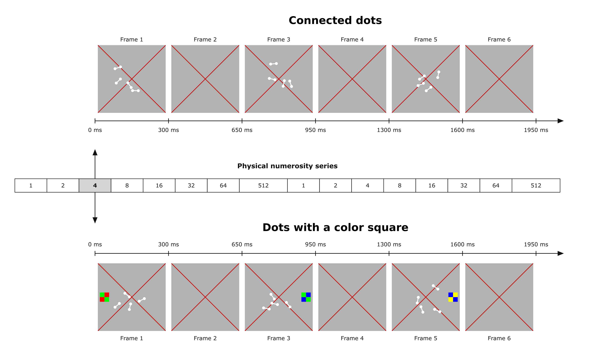
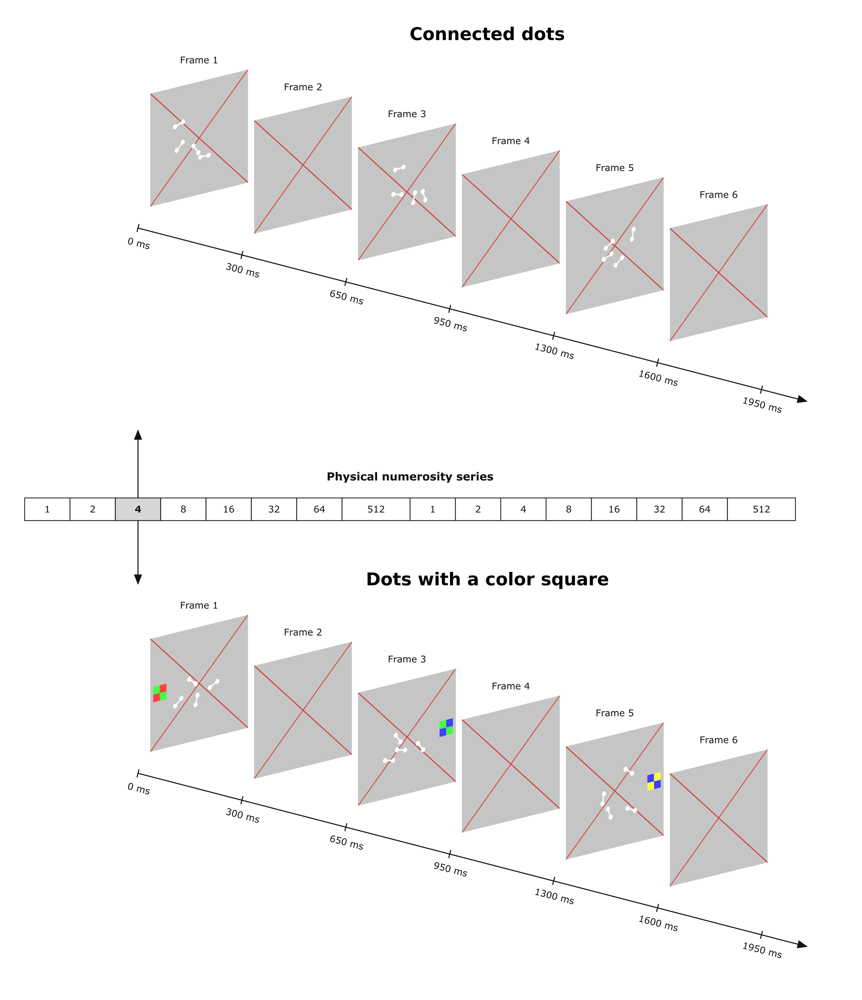

# Stimulus Figures

生成用于论文、海报和汇报的点阵刺激示例与实验流程展示图。支持离散点、连接点、四色搭配色块、背景帧，以及横向／仿 3D 排列。

这是静态绘图工具。图中的时间和数量序列是说明文字；程序不运行实验、不控制呈现时序，也不自动平衡实验条件。



<details>
<summary>查看仿 3D 示例</summary>



</details>

## 快速开始

需要 Python 3.9 或更新版本。原生 SVG 流程图和单张素材的 SVG/EPS/PDF/PNG 导出只需要 Matplotlib。

```bash
python3 -m venv .venv
source .venv/bin/activate
python -m pip install -r requirements.txt
python generate_figures.py --config examples/demo.json
```

Windows 的环境激活命令为 `.venv\Scripts\activate`。也可以在安装依赖后直接使用自己已有的 Python 环境。

生成结果：

```text
output/demo/
├── assets/                     # 刺激素材：默认 SVG 和 EPS
├── titles/                     # 独立标题素材
├── procedure_horizontal.svg    # 完整流程图
└── config_used.json             # 本次实际使用的配置
```

相同配置、素材 ID 和种子得到相同点阵。再次运行会覆盖同目录下同名产物；要保留多个版本，请指定不同的 `--output`。程序不会清空整个输出目录，因此旧文件可能仍在。

## 常用命令

```bash
# 先检查配置、字体和本次需要的转换工具，不生成图片
python generate_figures.py --config examples/demo.json --check

# 仿 3D 排列
python generate_figures.py --config examples/demo.json --layout 3d --output output/demo_3d

# 同时导出完整流程图的 PDF 和 PNG（需要 Inkscape）
python generate_figures.py --config examples/demo.json --formats svg,pdf,png

# 批量生成单张素材，包含离散点、连接点、色块和背景
python generate_figures.py --config examples/stimuli_only.json

# 从已有流程配置中只生成素材
python generate_figures.py --config examples/demo.json --assets-only

# 使用手动选好的矢量图片
python generate_figures.py --config examples/external_svg.json
```

`--config`、`--output` 命令行路径相对于当前工作目录；JSON 内的 `source` 和 `output_dir` 相对于该 JSON 文件。可以从其他目录通过脚本的绝对路径运行，没有用户电脑上的固定路径。

安装为命令行工具也是可选的：

```bash
python -m pip install -e .
stimulus-figures --config examples/demo.json
# 或 python -m stimulus_figures --config examples/demo.json
```

## 改图的方法

复制一份 `examples/demo.json`，主要修改以下内容：

1. `stimuli`：给每张素材命名，指定模式、点数、色块等。
2. `rows`：写标题，并按 ID 列出各帧。可重复使用同一素材，例如背景帧。
3. `times_ms`：时间刻度，长度必须比每行帧数多 1。
4. `figure`：布局、字号、间距、字体和仿 3D 外观。
5. `physical_series`：可选数量序列标注；不需要时删除或设为 `[]`。

例如，生成一个离散点图和一个连接点图，均为 16 个点：

```json
{
  "output_dir": "output/comparison",
  "stimuli": [
    {"id": "isolated", "dot_mode": "isolated", "n_dots": 16},
    {"id": "connected", "dot_mode": "connected", "n_pairs": 8}
  ],
  "rows": [
    {"title": "Illustration", "stimuli": ["isolated", "connected"]}
  ],
  "times_ms": [0, 300, 650]
}
```

`n_pairs` 是连接对数：4 对等于 8 个圆点。两个素材默认分别随机布点，点数相同并不意味着位置相同。这里只是展示图配置示例，不定义实验比较方式。

完整字段、默认值和输入限制见 [配置说明](docs/configuration.md)。

## 可选转换工具

| 操作 | 依赖 |
|---|---|
| 原生素材及 SVG 流程图 | Python + Matplotlib |
| 将完整 SVG 流程图导出为 PDF/PNG | 额外需要 Inkscape |
| 导入已有 SVG | 无额外工具；应为自包含 SVG |
| 导入已有 PDF（第 1 页） | Inkscape |
| 导入已有 EPS | Inkscape + Ghostscript |
| 将导入的 SVG 素材另存 EPS/PDF/PNG | Inkscape |

可从系统包管理器或应用官网安装 Inkscape 和 Ghostscript。安装后用 `inkscape --version`、`gs --version` 检查。macOS 也会查找 `/Applications/Inkscape.app/Contents/MacOS/inkscape`。

没有 Inkscape 时，使用默认的 `figure_formats: ["svg"]` 即可。SVG 可直接在浏览器或矢量编辑器中打开。转换失败会返回非零退出码并说明原因，已经生成的 SVG 会保留。

## 使用边界

- 保留原型的灰背景、红 X、圆点、连接线及色块构造；流程图布局重新整理，未承诺与历史文件逐像素一致。
- 三种模式在相同尺寸配置下使用相同画布。时间轴的帧间距是示意排版，不按毫秒差值等比例绘制。
- 数量序列（包括 `512`）只是标注，不触发对应点数的生成。
- 保留人工选图流程。随机点阵保证基本点间距，不保证连接线之间完全没有交叉；展示前检查效果，不满意时修改种子。
- 原生刺激和标题保持矢量。标题文字导出为轮廓以保持字体外观；要改标题请修改配置重新生成。
- 外部 SVG 请使用自包含的普通 SVG，图片嵌入、文字转路径；不支持脚本、外部链接和依赖网页环境的 SVG。输入 PDF 只取第 1 页。
- 默认字体为 Matplotlib 自带的 DejaVu Sans。中文标题需在 `figure.font_family` 中指定本机已安装、包含中文字形的字体。

## 开发与验证

```bash
python -m unittest discover -s tests -v
# 安装了 Inkscape / Ghostscript 后，再验证转换链路：
python tests/check_converters.py
```

GitHub Actions 配置了 Python 3.9/3.12 的测试、示例出图，以及 Linux 上的转换验证。

本地已验证环境：Python 3.9.6、Matplotlib 3.9.4、Inkscape 1.4.3、Ghostscript 10.06.0。GitHub Actions 需要推送后才会实际运行。

项目结构与从旧脚本迁移的方法见 [迁移说明](docs/migration.md)。发布前的检查步骤见 [GitHub 发布说明](docs/publishing.md)。
